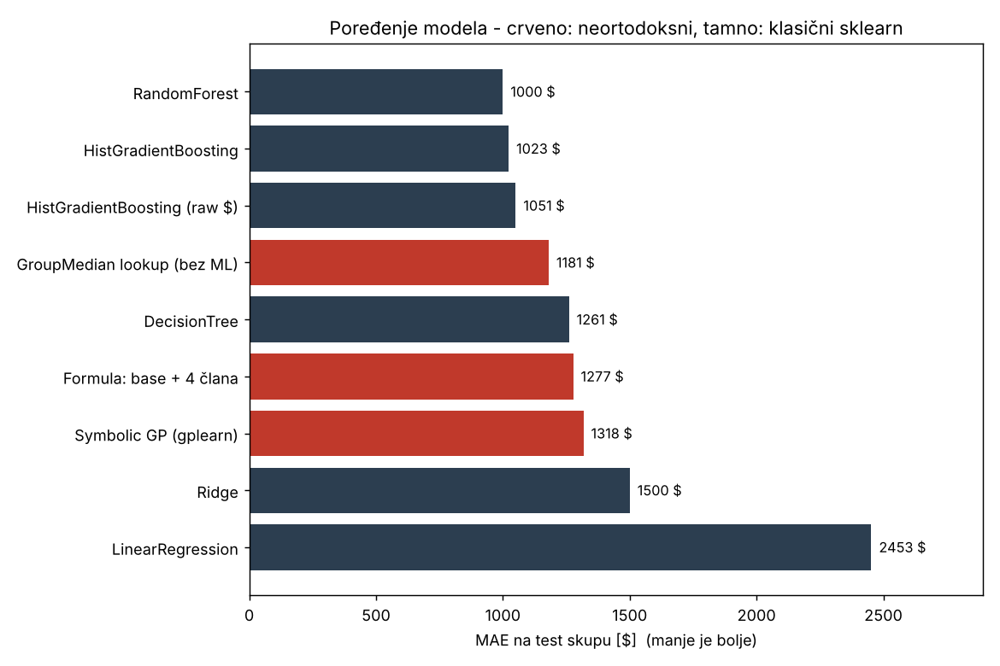
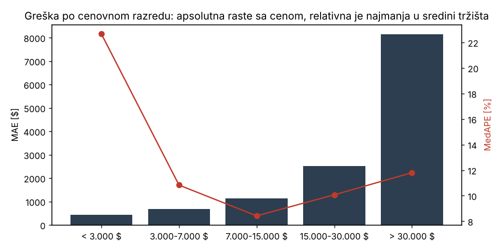
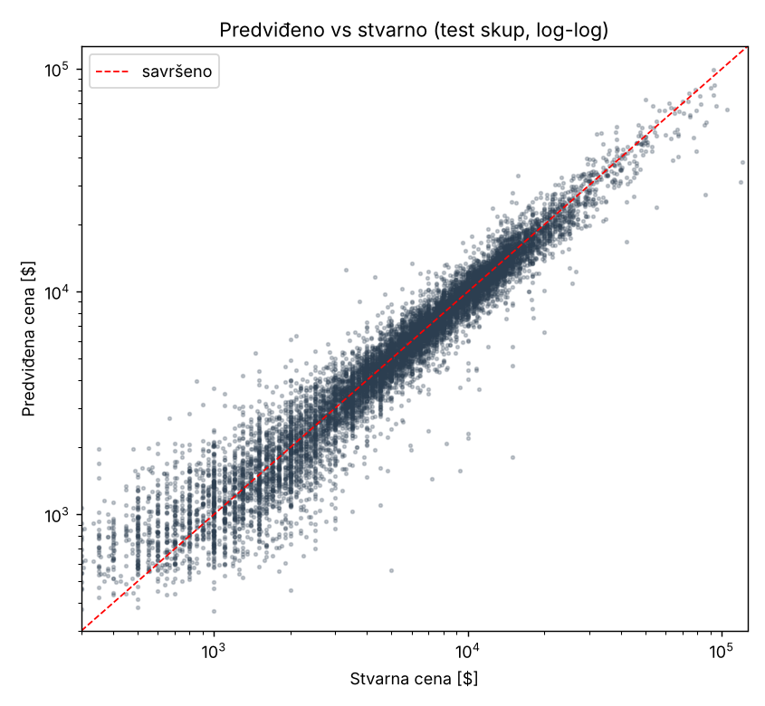

# Predviđanje cene polovnog automobila (regresija)

Regresioni ML projekat koji na osnovu karakteristika automobila (marka, model, godina,
kilometraža, gorivo, zapremina, menjač, pogon, stanje, segment, boja) procenjuje njegovu
tržišnu cenu u dolarima (`priceUSD`). Ceo tok - EDA → čišćenje → inženjering karakteristika
→ pretprocesiranje → treniranje i poređenje modela → evaluacija - je u skriptama u `src/`,
a sveske u `notebooks/` ga objašnjavaju korak po korak.

**Rezultat:** finalni model (HistGradientBoosting, log-cilj) na test skupu od 11.034 oglasa ima
**MAE = 1.023 $**, RMSE = 2.319 $, **R² = 0,914**, medijana relativne greške 11,9 %.
Za polovinu automobila procena je unutar ±12 % stvarne cene.

Pored klasičnih sklearn regresora, u poređenje ulaze i tri **neortodoksna** pristupa:
procenitelj bez mašinskog učenja (medijana istih vozila), model koji je **sam izveo formulu**
cene, i genetsko programiranje. Svi su mereni na istom test skupu, pa tabela iskreno pokazuje
gde ML donosi vrednost, a gde ne.

---

## Sadržaj

1. [Skup podataka](#1-skup-podataka)
2. [Struktura projekta](#2-struktura-projekta)
3. [Pokretanje od nule](#3-pokretanje-od-nule)
4. [Šta sam primetio u podacima (EDA)](#4-šta-sam-primetio-u-podacima-eda)
5. [Čišćenje podataka](#5-čišćenje-podataka)
6. [Inženjering karakteristika](#6-inženjering-karakteristika)
7. [Pretprocesiranje](#7-pretprocesiranje)
8. [Modeli i poređenje](#8-modeli-i-poređenje)
9. [Finalni model i evaluacija](#9-finalni-model-i-evaluacija)
10. [Predikcija za novi automobil](#10-predikcija-za-novi-automobil)
11. [Ograničenja i šta bih sledeće radio](#11-ograničenja-i-šta-bih-sledeće-radio)

---

## 1. Skup podataka

`data/cars.csv` - 56.244 oglasa polovnih automobila, 12 kolona:

| Kolona | Opis | Tip |
|---|---|---|
| `make`, `model` | marka i model | tekst (96 marki, 1.034 modela) |
| `priceUSD` | **ciljna promenljiva**, cena u $ | broj (48 - 235.235, medijana 5.350) |
| `year` | godina proizvodnje | broj (1910 - 2019) |
| `condition` | `with mileage` / `with damage` / `for parts` | tekst |
| `mileage(kilometers)` | kilometraža | broj |
| `fuel_type` | `petrol` / `diesel` / `electrocar` | tekst |
| `volume(cm3)` | zapremina motora | broj |
| `color`, `transmission`, `drive_unit`, `segment` | boja, menjač, pogon, segment (A-S) | tekst |

Najnovija godina u skupu je 2019 - to je godina snimka podataka i referentna godina za starost.

## 2. Struktura projekta

```
car-price-prediction/
├── data/
│   ├── cars.csv                    # sirovi podaci
│   └── processed/                  # generiše se skriptama
│       ├── cars_clean.csv          #   posle čišćenja (+ cleaning_report.json)
│       ├── cars_features.csv       #   + nove karakteristike
│       └── train.csv, test.csv     #   fiksna podela 80/20 (random_state=42)
├── notebooks/
│   ├── 01_eda.ipynb                # istraživanje podataka i odluke
│   └── 02_modeling.ipynb           # tok rešenja, poređenje, evaluacija, primer
├── src/
│   ├── config.py                   # putanje, pragovi, konstante (jedno mesto)
│   ├── data_cleaning.py            # čišćenje
│   ├── feature_engineering.py      # nove karakteristike
│   ├── data_preprocessing.py       # cilj, kolone, ColumnTransformer, podela
│   ├── baselines.py                # neortodoksni modeli (lookup, formula, GP)
│   ├── model_comparison.py         # poređenje 9 modela + CV + interval
│   ├── model_training.py           # treniranje i čuvanje finalnog modela
│   ├── model_evaluation.py         # metrike, tumačenje, grafici
│   └── predict.py                  # procena za jedan automobil (CLI)
├── models/
│   ├── car_price_model.joblib      # finalni pipeline (preprocessor + model)
│   ├── car_price_model_metadata.json
│   ├── car_price_interval_q10.joblib, car_price_interval_q90.joblib  # interval od-do
│   └── car_price_formula.joblib    # čitljivi formula-model
├── reports/                        # tabele i grafici koje prave skripte
├── run_all.sh                      # ceo tok jednom komandom
├── requirements.txt
└── README.md
```

## 3. Pokretanje od nule

Potreban je Python 3.11+ (razvijeno i provereno na 3.13; pinovane verzije u `requirements.txt` traže 3.11+).

```bash
git clone https://github.com/arhistrategstudio/car-price-prediction.git
cd car-price-prediction
python -m venv .venv
source .venv/bin/activate          # Windows: .venv\Scripts\activate
pip install -r requirements.txt
```

Ceo tok jednom komandom (skripte se pokreću iz korena projekta):

```bash
bash run_all.sh            # sve: ~6 min na 2 jezgra (genetsko programiranje je najsporije)
bash run_all.sh --fast     # bez genetskog programiranja i CV: ~2 min
```

Ili korak po korak, istim redosledom:

```bash
python src/data_cleaning.py          # data/cars.csv -> data/processed/cars_clean.csv
python src/feature_engineering.py    # -> data/processed/cars_features.csv
python src/data_preprocessing.py     # -> data/processed/train.csv, test.csv
python src/model_comparison.py       # 9 modela na istoj podeli -> reports/model_comparison.md  (--fast = bez GP i CV)
python src/model_training.py         # finalni model -> models/car_price_model.joblib (+ interval + formula)
python src/model_evaluation.py       # metrike, tabele, grafici -> reports/
python src/predict.py --make volkswagen --model golf --year 2014 --condition "with mileage" \
    --mileage 180000 --fuel diesel --volume 1600 --color black --transmission mechanics \
    --drive "front-wheel drive" --segment C
```

Sveske: `jupyter notebook notebooks/` (obe su već izvršene, pa se rezultati vide i bez
pokretanja; `02_modeling.ipynb` čita `reports/`, pa skripte treba pokrenuti pre nje).

Svi slučajni procesi imaju `random_state=42`, pa su brojevi u ovom README reproduktivni
(do male razlike u genetskom programiranju ako se promeni broj jezgara).

## 4. Šta sam primetio u podacima (EDA)

Detalji i grafici su u `notebooks/01_eda.ipynb`. Nalazi koji su odredili sve dalje odluke:

- **Cena je jako zakrivljena**: medijana 5.350 $, prosek 7.415 $, maksimum 235.235 $ (Bentley).
  U log-skali raspodela je skoro simetrična → modeli uče `log1p(cena)`.
- **Godina je ubedljivo najjači signal** (korelacija 0,81 sa log-cenom). Kilometraža sama
  za sebe je slab signal (−0,05!) jer stariji auti imaju i više km i nižu cenu, pa se efekti
  mešaju.
- **Maksimalna godina je 2019** → starost se računa od 2019, ne od današnje godine.
- **Prljave vrednosti koje prodavci unose rukom**: kilometraže od 9.999.999 km, 1.111.111 km,
  333.333 km, 123.456 km; zapremine od 20.000 cm³ (tipfeler umesto 2.000); cene od 48 $ i
  100 $; godine 1910 - 1979 (oldtajmeri).
- **`for parts`** (454 oglasa, medijana 400 $) je tržište delova, a ne automobila.
- **Marka `eksklyuziv`** nije marka nego kategorija "sve ostalo" (retro, vojna tehnika, karting, samogradnja).
- **Nedostaje**: `segment` 9,4 %, `drive_unit` 3,4 %, `volume(cm3)` 47 redova (tačno električni automobili).
- **1.071 par marka+model**, pola njih ima ≤ 10 oglasa → OneHot bi dao 1.000+ retkih kolona.
- 87 potpuno identičnih redova (duplikati).

## 5. Čišćenje podataka

`src/data_cleaning.py` (56.244 → 55.169 redova; izveštaj u `data/processed/cleaning_report.json`):

| Problem | Odluka | Broj redova |
|---|---|---|
| nazivi `mileage(kilometers)`, `volume(cm3)` | preimenovano u `mileage_km`, `volume_cm3` | - |
| identični duplikati | obrisani | 87 |
| `condition == for parts` | izbačeni - cena delova nije cena automobila; `with damage` ostaje kao karakteristika | 454 |
| marka `eksklyuziv` | izbačena - nije marka | 55 |
| godina < 1980 | izbačeni - oldtajmerima cena *raste* sa starošću, suprotna zakonitost | 244 |
| cena < 300 $ | izbačeni - placeholder ("1", "100"), ne tržišna cena | 235 |
| kilometraža ≥ 1.000.000 km | → NaN (1111111, 9999999, 3456789...) | 357 |
| kilometraža sa ponovljenim ciframa / nizovima (111111, 333333, 123456...) | → NaN ("ne znam" kucano u obavezno polje) | 673 |
| kilometraža < 1.000 km na vozilu starom 2+ god. | → NaN (nije uneta) | 2.332 |
| zapremina > 7.000 cm³ | podeljena sa 10 (tipfeler: mazda 3 = 20000) | 87 |
| zapremina kod električnih vozila | 0 (nema motor sa zapreminom) | 45 |
| nedostajući `segment` / `drive_unit` | najčešća vrednost istog make+model, inače `unknown` | 29 + 1.805 popunjeno iz modela; 5.030 + 7 `unknown` |
| kategorijske vrednosti | mala slova, bez praznina (segment velikim slovom) | - |

Ključni principi: **red se briše samo kad je cilj ili tržište pogrešno** (cena, `for parts`,
oldtajmeri); kad je pogrešna jedna ulazna vrednost, ona postaje NaN i ostatak reda ostaje -
kilometražu posle popunjava `SimpleImputer` uz indikator "bila je nepoznata", što je samo
po sebi signal. Posle čišćenja jedina kolona sa NaN je `mileage_km` (3.362 reda, 6 %).

## 6. Inženjering karakteristika

`src/feature_engineering.py` dodaje tri karakteristike, svaku sa jasnom svrhom:

| Karakteristika | Definicija | Zašto |
|---|---|---|
| `car_age` | `2019 − year` | starost određuje amortizaciju, ne kalendarska godina; referenca je 2019 (godina snimka), jer bi računanje od 2026. dodalo 7 lažnih godina svakom autu |
| `mileage_per_year` | `mileage_km / max(car_age, 1)` | razdvaja "star auto sa malo km" od "mlad auto koji je bio taksi"; delilac ≥ 1 da nova vozila ne dele nulom |
| `brand_model` | `make + "_" + model` | nazivi modela nisu jedinstveni ("3" je i mazda 3 i bmw 3-seriya); par marka+model nosi "osnovnu cenu" vozila |

Predložene a **svesno neuvedene**: `engine_volume_liters` (samo `volume_cm3/1000` - linearno
skaliranje ne nosi novu informaciju, stabla su na njega neosetljiva, a linearni model ga već
dobija kroz `StandardScaler`), `is_newer_car` i `is_high_mileage` (fiksni pragovi na kolonama
koje model već ima - stabla sama nađu bolji prag, dodali bi kolone, ne informaciju).

Pošten nalaz posle evaluacije: permutaciona važnost pokazuje da `car_age` nosi daleko najviše
(izmešana diže MAE za 4.046 $), `brand_model` 1.119 $, `volume_cm3` 843 $, a `mileage_per_year`
svega 22 $ - kilometraža po godini je zadržana jer ne šteti i ima smisla, ali model je
većinu te informacije već izvukao iz starosti i kilometraže. Boja ne znači praktično ništa (5 $).

## 7. Pretprocesiranje

`src/data_preprocessing.py` - jedan `ColumnTransformer` koji dele svi modeli:

| Kolone | Transformer | Napomena |
|---|---|---|
| `car_age`, `mileage_km`, `volume_cm3`, `mileage_per_year` | `SimpleImputer(median, add_indicator=True)` + `StandardScaler` | indikator pamti nepoznatu kilometražu; skaliranje treba linearnim modelima, stablima ne smeta |
| `make`, `condition`, `fuel_type`, `color`, `transmission`, `drive_unit`, `segment` | `OneHotEncoder(handle_unknown="infrequent_if_exist", min_frequency=10)` | retka ili nepoznata vrednost ide u "infrequent" kolonu umesto da obori pipeline |
| `brand_model` (1.044 vrednosti) | `TargetEncoder` (prosečna log-cena modela, cross-fitting na treningu) | OneHot bi dao 1.000+ retkih kolona; cross-fitting sprečava da model "vidi" sopstvenu cenu |

- `OrdinalEncoder` nije korišćen: `segment` (A, B, C, D, E, F, J, M, S) nije uređen - J je SUV,
  M minivan, S sportski.
- `year` je isključen (kolinearan sa `car_age`), `model` je zamenjen sa `brand_model`.
- **Cilj**: `priceUSD` se uči kao `log1p` kroz `TransformedTargetRegressor`; sve metrike se
  računaju u dolarima posle inverzne transformacije.
- **Podela**: 80/20, `random_state=42`, sačuvana na disk (`train.csv` 44.135, `test.csv` 11.034
  redova) - sve skripte čitaju iste fajlove, pa je poređenje fer.
- Matrica posle transformacije: 107 kolona.

## 8. Modeli i poređenje

`src/model_comparison.py` trenira svih 9 modela na istom train skupu i meri ih na istom
test skupu. Hiperparametri za boosting i random forest su izabrani 3-fold CV pretragom
(12 nasumičnih kombinacija za boosting; razlika najbolje i najgore je bila 1.029 - 1.100 $ MAE).

| model | cilj | MAE [$] | RMSE [$] | R² | MedAPE | trening |
|:--|:--|--:|--:|--:|--:|--:|
| RandomForest (300 stabala) | log | **1.000** | 2.325 | 0,914 | 11,6 % | 27 s |
| **HistGradientBoosting** (finalni) | log | **1.023** | 2.319 | 0,914 | 11,9 % | 7 s |
| HistGradientBoosting | $ (sirovo) | 1.051 | **2.225** | **0,921** | 12,2 % | 5 s |
| *GroupMedian lookup (bez ML)* | $ | 1.181 | 3.207 | 0,836 | 12,2 % | 0 s |
| DecisionTree | log | 1.261 | 2.899 | 0,866 | 13,9 % | 0 s |
| *Formula: osnovna cena + 4 člana* | log | 1.277 | 3.035 | 0,853 | 14,3 % | 0 s |
| *Symbolic GP (gplearn)* | log | 1.318 | 3.334 | 0,823 | 14,3 % | 151 s |
| Ridge | log | 1.500 | 3.418 | 0,814 | 16,6 % | 0 s |
| LinearRegression | $ | 2.453 | 4.504 | 0,676 | 29,9 % | 1 s |



5-fold cross-validation na treningu (stabilnost): RandomForest 1.040 ± 11 $, HistGradientBoosting
1.050 ± 20 $, HistGradientBoosting u sirovoj skali 1.080 ± 20 $. **Razlika između dva najbolja je
manja od standardne devijacije po foldovima - statistički su nerazlučivi.**

### Šta tabela govori

1. **Procenitelj bez ML-a tuče tri ML modela.** Medijana cene istih vozila iz treninga
   (hijerarhijski: marka+model+godina → marka+model → marka) daje MAE 1.181 $, bolje od
   LinearRegression, Ridge i stabla odlučivanja. To je prava nulta tačka: ako sistem ne pobedi
   tabelu medijana, nema razloga da postoji. Ensemble modeli je pobeđuju za ~15 % po MAE i za
   ~28 % po RMSE (lookup nema šta da kaže za retke kombinacije, ML uopštava).
2. **Log-cilj vredi.** Isti boosting u sirovoj skali ima bolji RMSE i R² (jer te metrike
   dominiraju skupi auti), ali lošiji MAE i medijanu relativne greške - u sirovoj skali model
   "juri" skupe aute na račun jeftinih, kojih je 90 % tržišta. Zadatak traži da se gleda MAE.
3. **Formula koju je mašina izvela** (`src/baselines.py`, `FormulaRegressor`): cena se rastavi
   na osnovnu cenu modela (tabela od ~1.000 brojeva, target encoding očišćen od trenda starosti)
   i formulu amortizacije. Lasso bira članove iz biblioteke kandidata (age, age², log(age+1), km,
   km², liters, log(liters+1), damaged, age·km, km/(age+1)...), a običan OLS procenjuje koeficijente:

   ```
   log(cena) = osnovna(marka_model) + 9,850 − 0,1002·starost + 0,1862·log(litri+1) − 0,6643·oštećen − 0,0013·starost·km
   ```

   Čitanje: svaka godina starosti skida **~9,5 %** cene (e^−0,1002), oštećenje skida **~49 %**
   (e^−0,664), veći motor diže cenu, a kilometraža boli više što je auto stariji. Sa samo 4
   člana ima R² 0,853 - to je jedini model čiji ceo "mozak" staje na tablu.
4. **Genetsko programiranje** (gplearn) je najneortodoksniji pristup i prijavljen je iskreno:
   radi (1.318 $) samo uz pažljivo podešavanje (funkcije add/sub/mul/div, populacija 4.000,
   50 generacija, blaga parsimony kazna); sa log/sqrt u skupu funkcija ili jačom kaznom
   evolucija se "sruši" u konstantu. Izvedena formula je rogobatna, ali se u njoj vidi isti
   koeficijent **−0,122·starost** i **−1,0·oštećen**. Zaključak: evolucija nađe istu fiziku
   tržišta kao Lasso, ali mnogo skuplje i nepouzdanije.
5. **RandomForest vs HistGradientBoosting**: razlika 23 $ (2 %) je unutar šuma CV foldova.
   Biram HistGradientBoosting jer je 4× brži, model je 3 MB umesto **1,17 GB** (random forest sa
   300 punih stabala na 44.000 redova - ne staje ni na GitHub), i isti algoritam daje kvantilnu
   regresiju za interval od-do.

### Interval "od-do" (kvantilni boosting)

Platforma traži *okvirnu* cenu, pa pored tačkaste procene model daje i interval:
dva `HistGradientBoostingRegressor(loss="quantile")` za 10. i 90. percentil
(`models/car_price_interval_q10/q90.joblib`). Na test skupu interval pokriva **77,1 %** stvarnih
cena (cilj 80 %) uz medijanu širine 2.149 $ (58 % donje granice). Plići kvantilni modeli daju
79 %, ali 13 % širu traku; duboki (isti kao tačkasti model) samo 72 %. Izabran je srednji
kompromis - interval je blago optimističan i to treba reći korisniku.

## 9. Finalni model i evaluacija

**Finalni model**: `HistGradientBoostingRegressor(max_iter=800, learning_rate=0.05,
max_leaf_nodes=127, min_samples_leaf=10, l2_regularization=1.0, max_features=0.7)` u log-skali
cilja, sa preprocessorom iz tačke 7, sačuvan kao jedan pipeline u `models/car_price_model.joblib`
(`src/model_training.py`). Treniran je samo na train skupu da bi evaluacija na testu bila poštena.

`src/model_evaluation.py` na test skupu (11.034 oglasa):

| metrika | vrednost | tumačenje |
|---|--:|---|
| **MAE** | **1.023 $** | model u proseku promaši za toliko; medijana cene u testu je 5.500 $, pa je to 19 % medijane |
| MedAPE | 11,9 % | za polovinu automobila relativna greška je ispod 12 % |
| MSE | 5,38 · 10⁶ | kvadrat greške, u $² - teško za čitanje, zato RMSE |
| RMSE | 2.319 $ | veći od MAE jer kvadrira greške: vuku ga retki veliki promašaji na skupim autima |
| R² | 0,914 | model objašnjava 91 % varijanse cene |

Primeri sa test skupa (nasumičnih 12, `reports/evaluation_examples.csv`):

| make | model | year | km | stvarna cena | predviđena cena | greška |
|---|---|--:|--:|--:|--:|--:|
| toyota | corolla-verso | 2005 | 350.000 | 7.250 | 7.149 | 101 |
| skoda | octavia | 2009 | 159.000 | 7.800 | 7.260 | 540 |
| lada-vaz | xray | 2019 | 2.500 | 11.450 | 11.964 | 514 |
| volkswagen | golf | 1996 | 120.000 | 808 | 1.577 | 769 |
| infiniti | fx | 2011 | 120.000 | 19.750 | 18.882 | 868 |
| nissan | primera | 1997 | 300.000 | 1.188 | 1.626 | 438 |
| renault | megane | 1998 | 380.000 | 2.000 | 1.482 | 518 |
| toyota | corolla | 1996 | 271.000 | 1.590 | 1.274 | 316 |
| volkswagen | passat | 2008 | 142.000 | 8.300 | 8.077 | 223 |
| volkswagen | golf-plus | 2011 | 130.600 | 7.700 | 8.171 | 471 |
| chevrolet | trax | 2017 | 36.000 | 14.900 | 13.790 | 1.110 |
| renault | megane | 2004 | 480.000 | 3.325 | 3.158 | 167 |

Greška nije ista po celom tržištu (`reports/evaluation_by_price_band.csv`):

| cenovni razred | n | MAE [$] | MedAPE |
|---|--:|--:|--:|
| < 3.000 $ | 3.259 | 440 | 22,7 % |
| 3.000 - 7.000 $ | 3.433 | 681 | 10,8 % |
| 7.000 - 15.000 $ | 3.250 | 1.141 | 8,4 % |
| 15.000 - 30.000 $ | 905 | 2.521 | 10,1 % |
| > 30.000 $ | 187 | 8.144 | 11,8 % |



Apsolutna greška raste sa cenom (što je prirodno), a relativna je **najmanja u sredini tržišta**
(7-15 hiljada $, gde ima najviše podataka). Na jeftinim autima (< 3.000 $, stari 20+ godina)
relativna greška je 23 %: kod auta od 1.000 $ razlika od 300 $ je 30 %, a za to odlučuje stanje
koje u podacima ne postoji (servisna istorija, korozija, pregovor). Najveći promašaji
(`reports/evaluation_worst.csv`) su skupi i retki automobili: Range Rover 2018 (stvarno 118.000 $,
predviđeno 30.950 $), Bentley Mulsanne, Tesla Model 3 - model je video premalo primeraka tog
modela i godišta, pa ih vuče ka prosečnom (starijem) Range Roveru. Tu ni iskusan procenitelj
ne bi bio siguran, i zato platforma dobija i interval od-do.



Permutaciona važnost (`reports/figures/feature_importance.png`) potvrđuje intuiciju: starost
daleko ispred svega, pa marka+model, zapremina, marka, pogon, segment, kilometraža, gorivo,
menjač; stanje i boja na dnu.

## 10. Predikcija za novi automobil

Primer iz teksta zadatka:

```bash
python src/predict.py --make volkswagen --model golf --year 2014 --condition "with mileage" \
    --mileage 180000 --fuel diesel --volume 1600 --color black --transmission mechanics \
    --drive "front-wheel drive" --segment C
```

```
Procenjena cena: 12,159 $
Okvirno od-do (10.-90. percentil): 10,843 $ - 13,196 $
Formula-model kaže: 13,498 $
  log(price) = base(brand_model) +9.850 -0.1002*age +0.1862*log(liters+1) -0.6643*damaged -0.0013*age*km
```

Za proveru: u skupu je 29 dizel golfova 2013-2015, medijana im je 12.200 $ (raspon 10.500 - 15.514 $),
pa je procena od 12.159 $ tačno tamo gde je tržište. (Tekst zadatka pominje "na primer 9.990 $" -
to je ilustracija formata, ne cena iz ovih podataka.)

`predict.py` prolazi kroz iste korake kao trening (standardizacija, popravka zapremine,
`unknown` za nepoznat segment/pogon, izvedene karakteristike), pa radi i sa delimičnim unosom:
`--make`, `--model` i `--year` su obavezni, ostalo ima podrazumevane vrednosti ili `unknown`.
Umesto argumenata može i `--json auto.json` sa istim ključevima kao kolone u `cars.csv`.

## 11. Ograničenja i šta bih sledeće radio

- Cene su iz 2019. i sa jednog tržišta; za produkciju bi se model ponovo trenirao na svežim
  oglasima (isti pipeline, `python src/model_training.py`), a `REFERENCE_YEAR` u `config.py`
  bi bila godina novih podataka.
- Skupi i retki modeli (< 10 oglasa) su najslabija tačka - pomoglo bi više podataka ili
  spoljni cenovnik novih vozila kao ulaz.
- Interval od-do pokriva 77 % umesto 80 % - konformna kalibracija na posebnom skupu bi ga
  dovela tačno na cilj.
- Nema kolona koje najviše odlučuju kod starih auta (servisna istorija, broj vlasnika, oprema);
  tu je i plafon tačnosti ovog skupa.
